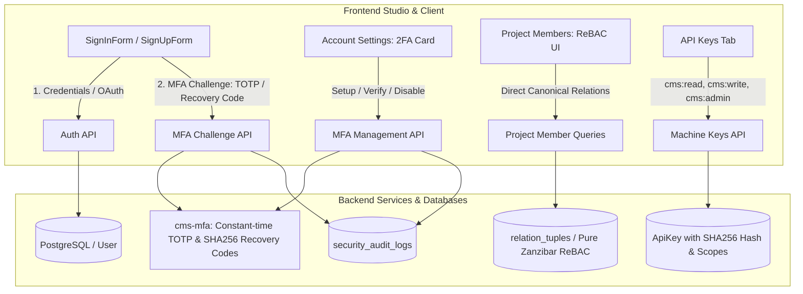

# Design Spec: Production-Ready Auth & ReBAC Alignment for Frontend Studio

- **Date**: 2026-10-12
- **Topic**: MedBrains-Style Auth & Zanzibar ReBAC Studio Alignment
- **Status**: Approved

---

## 1. Executive Summary

This specification outlines the end-to-end alignment of the CMS Studio frontend, SDK packages (`@cms/sdk`, `@cms/auth`), and backend API (`cms-api`) with the newly implemented Zanzibar-style Relationship-Based Access Control (ReBAC) and enhanced account security (Multi-Factor Authentication via TOTP & Recovery Codes, OAuth PKCE providers, and Machine API key scopes).

Legacy custom roles and 2D permission matrix code are eliminated. Canonical ReBAC relations (`owner`, `admin`, `member`, `viewer`) are surfaced across project and workspace governance with rich UX and ownership transfer workflows.

---

## 2. Architecture & Components

---

## 3. Detailed Technical Specifications

### 3.1 Backend MFA HTTP Endpoints (`crates/cms-api`)

Wired into `/auth` in `crates/cms-api/src/auth/mod.rs` & `handlers.rs`:

1. `POST /auth/mfa/setup` (Protected):
   - Generates enrollment bundle via `cms_mfa::generate_enrollment(&user.email, "Company CMS")`.
   - Generates 8 plaintext and SHA-256 hashed recovery codes via `cms_mfa::generate_recovery_codes(8)`.
   - Returns `{ secret: String, otpauth_uri: String, qr_png_base64: String, recovery_codes: Vec<String> }`.

2. `POST /auth/mfa/verify` (Protected):
   - Request body: `{ code: String, secret: String, recovery_codes: Vec<String> }`.
   - Verifies 6-digit TOTP code using `cms_mfa::verify_totp(&secret, &code)`.
   - On success, updates `User`: `mfa_enabled = true`, `mfa_secret = secret`, `mfa_recovery_codes = hashed_codes`.
   - Inserts audit event `mfa.enabled` into `security_audit_logs`.
   - Returns `{ success: bool }`.

3. `POST /auth/mfa/disable` (Protected):
   - Request body: `{ code: String }`.
   - Validates code against active `mfa_secret` or `mfa_recovery_codes`.
   - On success, sets `mfa_enabled = false`, `mfa_secret = NULL`, `mfa_recovery_codes = '{}'`.
   - Inserts audit event `mfa.disabled` into `security_audit_logs`.
   - Returns `{ success: bool }`.

4. `POST /auth/mfa/challenge` (Public):
   - Request body: `{ email: String, code: String, is_recovery_code: bool }`.
   - If `is_recovery_code`, verifies against user's stored `mfa_recovery_codes` with `cms_mfa::verify_recovery_code`. If verified, removes the consumed recovery code from DB.
   - If not recovery code, verifies against `user.mfa_secret` using `cms_mfa::verify_totp`.
   - On success, creates session, sets session cookies, and returns authenticated user and session.

5. Login Handler Flow (`login_handler`):
   - Validates credentials via `AuthService::login`.
   - If `user.mfa_enabled`, returns `200 OK` with JSON `{ mfa_required: true, email: user.email }` and does NOT issue session cookies yet.
   - Otherwise, issues normal session cookie.

---

### 3.2 Packages Layer (`@cms/sdk`, `@cms/auth`)

1. **`@cms/sdk`**:
   - Delete obsolete `packages/sdk/src/resources/roles.ts`.
   - Remove `roles` property and import from `CmsClient` in `packages/sdk/src/client.ts`.
   - In `packages/sdk/src/resources/auth.ts`, add methods:
     - `setupMfa(): Promise<MfaSetupResponse>`
     - `verifyMfa(payload: MfaVerifyPayload): Promise<{ success: boolean }>`
     - `disableMfa(payload: { code: string }): Promise<{ success: boolean }>`
     - `challengeMfa(payload: MfaChallengePayload): Promise<AuthSessionData>`

2. **`@cms/auth`**:
   - Add TanStack Query mutation hooks in `packages/auth/src/hooks/use-auth-mutations.ts`:
     - `useMfaSetup`, `useMfaVerify`, `useMfaDisable`, `useMfaChallenge`.
   - Update `SignInForm.tsx`:
     - Handle `mfa_required` response from sign-in.
     - Switch view to Step 2: 6-slot `InputOTP` with autofocus.
     - Provide fallback toggle to emergency recovery code input.
     - Support GitHub OAuth button alongside Google.

---

### 3.3 Studio Frontend Alignment (`apps/studio`)

1. **Delete Obsolete Files & Dead Code**:
   - `apps/studio/src/features/project-settings/components/project-roles-section.tsx` & `.test.tsx`
   - `apps/studio/src/features/project-settings/components/role-editor-panel.tsx`
   - `apps/studio/src/features/project-settings/components/workspace-roles-tab.tsx`
   - `apps/studio/src/features/workspace/WorkspaceRolesSection.tsx` & `.test.tsx`
   - `apps/studio/src/shared/hooks/api/roles.ts`

2. **ReBAC Project Members Section (`members-section.tsx`)**:
   - Eliminate tab switching between "Project Members" and "Roles & Permissions".
   - Replace custom role dropdown with clean canonical ReBAC relations:
     - `admin`: Configure project settings, git, domains, deployments, members.
     - `member`: Documentation authoring, editing, branching, and preview deployments.
     - `viewer`: Read-only viewer of project documentation and previews.
   - Display role badges (`Crown` for owner, `Shield` for admin, `Pencil` for member, `Eye` for viewer).
   - Dedicated "Transfer Ownership" modal dialog.

3. **Workspace Members & Settings**:
   - `WorkspaceMembersPage.tsx`: Remove "Roles & Permissions" tab. Keep direct member management with canonical roles (`owner`, `admin`, `member`).
   - `WorkspaceSettingsPage.tsx`: Remove `workspace-roles` tab, adhering strictly to company platform deployment rules (account & appearance only).

4. **Account Settings (`account-tab.tsx`) — 2FA Card**:
   - Shield badge showing 2FA status: Active or Inactive.
   - **Setup Modal**:
     - Step 1: Base64 QR code image + copyable base32 secret.
     - Step 2: Test 6-digit TOTP code.
     - Step 3: Emergency recovery codes modal (8 codes in monospace cards) with 1-click download `.txt` and copy all codes.
   - **Disable Dialog**: Confirmation modal with code challenge.

5. **Machine API Keys (`api-keys-tab.tsx`)**:
   - Update scopes:
     - `cms:read` — Read-only access to projects, pages, assets, deployments
     - `cms:write` — Content authoring, branch creation, deployments
     - `cms:admin` — Full administrative control

---

## 4. Verification & Testing Strategy

1. **Rust Backend**:
   - `cargo check --workspace` passes cleanly.
   - Integration tests in `crates/cms-api/tests/` verify MFA enrollment, verification, challenge, and recovery codes.
2. **TypeScript / Studio**:
   - `pnpm --filter @cms/studio typecheck` passes with zero type errors.
   - `pnpm --filter @cms/studio test` executes vitest suite with 100% test passing rate.
