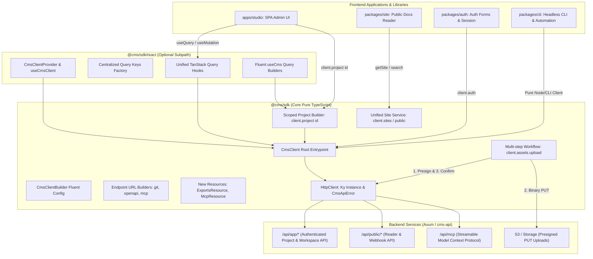

# Design Spec: Unified API Services & Fluent Builder Architecture for @cms/sdk

- **Date**: 2026-10-14
- **Topic**: Unique & Unified Service API in @cms/sdk with Fluent Builders & Zero Endpoint Leaks
- **Status**: Approved

---

## 1. Executive Summary

This specification defines the migration and unification of all frontend API interactions, domain services, URL generators, and multi-step workflows into `@cms/sdk`. 

Previously, API calls and route strings were fragmented across `apps/studio`, `packages/site`, and `packages/auth`:
- UI components contained hardcoded route strings (e.g. `/api/public/git/webhook/:id`, `/api/public/sites/:id/openapi.json`, `/api/mcp`).
- Multi-step network workflows (e.g., asset presign → PUT binary upload → confirm) performed direct browser `fetch()` calls inside UI mutation hooks.
- Ad-hoc service wrappers (`site-service.ts`, `auth-service.ts`) lived outside the SDK.
- Missing resources (Export jobs, Export schedules, MCP events) had no representation in the SDK.
- TanStack Query hooks were duplicated across `features/*/services/` and `shared/hooks/api/`.

This refactoring implements an **Advanced Fluent Builder Pattern** across `@cms/sdk`, introduces a dedicated `@cms/sdk/react` subpath export for TanStack Query, and guarantees that **zero raw API routes leak into frontend code**.

---

## 2. Architecture & System Boundaries



---

## 3. Detailed Technical Specifications

### 3.1 Pure Core `@cms/sdk` Architecture

The root entrypoint (`packages/sdk/src/index.ts`) remains **100% framework-agnostic**, ensuring zero dependencies on React or DOM APIs for CLI and server-side automation.

#### 3.1.1 Fluent Client Configuration Builder (`CmsClientBuilder`)

Replaces ad-hoc configuration objects with a type-safe fluent builder:

```typescript
export class CmsClientBuilder {
  private options: CmsClientOptions = {};

  static create(): CmsClientBuilder {
    return new CmsClientBuilder();
  }

  withBaseUrl(baseUrl: string): this;
  withHeaders(headers: Record<string, string> | (() => Record<string, string> | Promise<Record<string, string>>)): this;
  withLocale(getLocaleFn: () => string | undefined): this;
  withCredentials(credentials: RequestCredentials): this;
  withTimeout(timeoutMs: number): this;
  withRetry(retryOptions: { limit?: number; statusCodes?: number[] }): this;
  withCustomFetch(customFetch: typeof fetch): this;
  build(): CmsClient;
}
```

#### 3.1.2 Scoped Project Builder (`client.project(projectId)`)

Eliminates passing `projectId` as the first argument across dozens of resource calls:

```typescript
export class ScopedProjectContext {
  constructor(private readonly client: CmsClient, readonly projectId: string) {}

  readonly pages: ScopedPagesResource;
  readonly deployments: ScopedDeploymentsResource;
  readonly assets: ScopedAssetsResource;
  readonly git: ScopedGitResource;
  readonly domains: ScopedDomainsResource;
  readonly addons: ScopedAddonsResource;
  readonly apiKeys: ScopedApiKeysResource;
  readonly readerAccess: ScopedReaderAccessResource;
  readonly openapi: ScopedOpenApiResource;

  get(): Promise<ProjectResponse>;
  update(payload: UpdateProjectRequest): Promise<ProjectResponse>;
  delete(): Promise<{ success: boolean }>;
  getSettings<T = unknown>(): Promise<T>;
  updateSettings<T = unknown>(payload: unknown): Promise<T>;
  getTelemetry(): Promise<ProjectUsageTelemetryResponse>;
  getAnalytics(range?: string, timezone?: string): Promise<ProjectAnalyticsData>;
}
```

#### 3.1.3 Multi-Step Asset Upload Workflow (`client.assets.upload`)

Moves binary upload orchestration out of UI hooks directly into the SDK:

```typescript
export interface AssetUploadOptions {
  mimeType?: string;
  onProgress?: (bytesUploaded: number, totalBytes: number) => void;
}

export class AssetsResource {
  // Low-level primitives preserved:
  presign(projectId: string, payload: PresignAssetRequest): Promise<PresignAssetResponse>;
  confirm(projectId: string, payload: ConfirmAssetRequest): Promise<AssetResponse>;

  // High-level complete workflow:
  async upload(
    projectId: string,
    file: File | Blob | { name: string; size: number; arrayBuffer(): Promise<ArrayBuffer>; type?: string },
    options?: AssetUploadOptions
  ): Promise<AssetResponse>;
}
```

#### 3.1.4 Unified Site Service Migration (`client.sites` / `client.public`)

Transfers the full capabilities of `apps/studio/src/shared/services/site-service.ts` into `@cms/sdk`:

```typescript
export class SitesResource {
  getSite<T = SiteShell>(projectId: string, options?: { language?: string; version?: string }): Promise<T>;
  getPage<T = SitePage>(projectId: string, path: string, options?: { language?: string; version?: string }): Promise<T>;
  listChangelog<T = ChangelogEntry>(projectId: string): Promise<T[]>;
  getGitPreview(token: string): Promise<string>;
  search<T = SiteSearchHit>(projectId: string, query: string, options?: { language?: string; version?: string; limit?: number }): Promise<T[]>;
  answer<T = SearchAnswer>(projectId: string, query: string, options?: { language?: string; version?: string }): Promise<T>;
  recordEvent(projectId: string, event: SiteAnalyticsEvent): Promise<void>;
}
```

#### 3.1.5 Typed Endpoint URL Builders

Replaces raw string templates across frontend views with type-safe URL generators:

- **Git Webhooks**: `client.git.getWebhookUrl(projectId: string, baseUrl?: string): string`
  - Canonical format: `${origin}/api/public/git/webhook/${projectId}`
- **OpenAPI Public Spec**: `client.public.getOpenApiSpecUrl(projectId: string, baseUrl?: string): string`
  - Canonical format: `${origin}/api/public/sites/${projectId}/openapi.json`
- **MCP Endpoint**: `client.mcp.getEndpointUrl(baseUrl?: string): string`
  - Canonical format: `${origin}/api/mcp`

#### 3.1.6 New & Missing Backend Resources

- **`ExportsResource` (`client.exports`)**:
  - `listJobs(params?: { limit?: number; offset?: number }): Promise<ExportJob[]>`
  - `createJob(payload: CreateExportJobRequest): Promise<ExportJob>`
  - `getJob(jobId: string): Promise<ExportJob>`
  - `getDownloadUrl(jobId: string, artifactId?: string): string`
  - `listSchedules(projectId: string): Promise<ExportSchedule[]>`
  - `createSchedule(projectId: string, payload: CreateExportScheduleRequest): Promise<ExportSchedule>`
  - `updateSchedule(scheduleId: string, payload: UpdateExportScheduleRequest): Promise<ExportSchedule>`
  - `deleteSchedule(scheduleId: string): Promise<{ success: boolean }>`
  - `runSchedule(projectId: string, scheduleId: string): Promise<ExportJob>`
- **`McpResource` (`client.mcp`)**:
  - `listAuditEvents(params?: { limit?: number; offset?: number }): Promise<McpAuditEvent[]>`
  - `getEndpointUrl(baseUrl?: string): string`
- **`AiResource` (`client.ai`)**:
  - `prompt(projectId: string, payload: { prompt: string; context?: unknown }): Promise<{ result: string }>`

---

### 3.2 Subpath TanStack Query Export (`@cms/sdk/react`)

Provides the official TanStack Query v5 bindings for React applications under `@cms/sdk/react`.

#### 3.2.1 Package Configuration (`packages/sdk/package.json`)

```json
{
  "exports": {
    ".": {
      "import": "./src/index.ts",
      "types": "./src/index.ts"
    },
    "./react": {
      "import": "./src/react/index.ts",
      "types": "./src/react/index.ts"
    }
  },
  "peerDependencies": {
    "@tanstack/react-query": "^5.0.0",
    "react": "^18.0.0 || ^19.0.0"
  },
  "peerDependenciesMeta": {
    "@tanstack/react-query": { "optional": true },
    "react": { "optional": true }
  }
}
```

#### 3.2.2 React Context Provider

```tsx
import { createContext, useContext, ReactNode } from 'react';
import type { CmsClient } from '../client';

const CmsContext = createContext<CmsClient | null>(null);

export function CmsClientProvider({ client, children }: { client: CmsClient; children: ReactNode }) {
  return <CmsContext.Provider value={client}>{children}</CmsContext.Provider>;
}

export function useCmsClient(): CmsClient {
  const client = useContext(CmsContext);
  if (!client) {
    throw new Error('useCmsClient must be used within a CmsClientProvider');
  }
  return client;
}
```

#### 3.2.3 Centralized Query Keys Factory

Consolidates all query keys into `@cms/sdk/src/react/query-keys.ts`:
- `queryKeys.projects.all()`
- `queryKeys.projects.detail(projectId)`
- `queryKeys.pages.all(projectId, languageId, branchId)`
- `queryKeys.pages.detail(projectId, pageId)`
- `queryKeys.deployments.all(projectId)`
- `queryKeys.deployments.changes(projectId)`
- `queryKeys.domains.all(projectId)`
- `queryKeys.apiKeys.all(projectId)`
- `queryKeys.integrations.all(projectId)`
- `queryKeys.gitWorkflow.detail(projectId)`
- `queryKeys.site.shell(projectId)`
- `queryKeys.site.search(projectId, query, ...)`

#### 3.2.4 Unified React Query Hooks

Centralized hooks with built-in cache synchronization and invalidation:
- **Projects**: `useProjects()`, `useProject(id)`, `useCreateProject()`, `useUpdateProject(id)`, `useDeleteProject()`
- **Pages**: `usePages(projectId, lang?, branch?)`, `usePage(projectId, pageId)`, `useCreatePage(id)`, `useUpdatePage(id)`, `useDeletePage(id)`, `useReorderPages(id)`
- **Deployments**: `useDeployments(projectId)`, `usePendingChanges(projectId)`, `usePublish(projectId)`, `usePublishAnyway(projectId)`, `useRollback(projectId)`
- **Assets**: `useUploadAsset(projectId)` (calling `client.assets.upload`)
- **Settings**: `useDomains(id)`, `useApiKeys(id)`, `useOpenApiConfiguration(id)`, `useProjectAddons(id)`, `useWorkspaceSettings()`
- **Public & Site**: `useSite(projectId, options?)`, `useSitePage(projectId, path, options?)`, `useSiteSearch(projectId, query, ...)`

---

## 4. Frontend Studio Migration Plan

1. **Delete Ad-Hoc Services**:
   - Delete `apps/studio/src/shared/services/site-service.ts`.
   - Update all routes (`routes/sites/$projectId/*`, `routes/git-preview.$token.tsx`) to use the unified site service from `@cms/sdk` / `@cms/sdk/react`.

2. **Eliminate Raw Endpoint Leaks**:
   - `apps/studio/src/features/project-settings/components/git-workflow.tsx` & `git-tab.tsx`:
     Replace template `/api/public/git/webhook/${projectId}` with `cmsClient.git.getWebhookUrl(projectId)`.
   - `apps/studio/src/features/project-settings/components/api-keys-tab.tsx`:
     Replace `/api/mcp` with `cmsClient.mcp.getEndpointUrl()`.
   - `packages/site/src/lib/openapi-reference.ts`:
     Replace `/api/public/sites/${projectId}/openapi.json` with `cmsClient.public.getOpenApiSpecUrl(projectId)`.
   - `apps/studio/src/shared/hooks/api/mutations.ts`:
     Replace the manual presign + fetch PUT + confirm sequence with `cmsClient.assets.upload(projectId, file)`.

3. **Re-export Compatibility**:
   - In `apps/studio/src/shared/hooks/api/index.ts` and feature folders, re-export the unified hooks from `@cms/sdk/react` to ensure 100% backward compatibility for all existing pages without breaking tests.

---

## 5. Verification & Testing Strategy

1. **SDK Unit Tests (`packages/sdk/test/`)**:
   - Test `CmsClientBuilder` fluent configuration.
   - Test Scoped Project Context (`client.project(id)`).
   - Test `client.assets.upload` mock lifecycle (presign -> PUT -> confirm).
   - Test URL generators (`getWebhookUrl`, `getOpenApiSpecUrl`, `getEndpointUrl`).
   - Test `ExportsResource` and `McpResource`.

2. **React Hooks Integration Tests (`packages/sdk/test/react/`)**:
   - Test `CmsClientProvider` rendering and hook execution with `renderHook`.
   - Validate automatic cache invalidation on mutations (`usePublish`, `useCreatePage`, etc.).

3. **Studio Verification**:
   - Run `pnpm --filter @cms/studio test` to ensure existing component and page tests pass.
   - Run type checks: `pnpm --filter @cms/sdk typecheck` and `pnpm --filter @cms/studio typecheck`.
   - Validate frontend build succeeds: `pnpm --filter @cms/studio build`.
