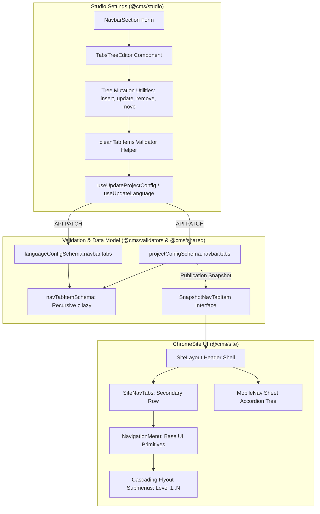

# Design Spec: Navbar Infinite Nested Tabs & NavigationMenu in ChromeSite UI

- **Date**: 2026-10-15
- **Topic**: Studio Navbar Tabs Infinite Nesting & ChromeSite UI NavigationMenu Rendering
- **Status**: Approved by User (Proceeding to Implementation Plan)

---

## 1. Executive Summary

This specification addresses three connected features for CMS navigation:
1. **Infinite Nested Tabs**: Enabling projects to define multi-level navigation hierarchies (`navbar.tabs`) of arbitrary depth.
2. **Studio Settings UI Tree Editor**: Modernizing the Navbar settings tab in `@cms/studio` (`NavbarSection`) from a flat 1D list into a hierarchical tree editor with nesting guides, depth badges, expand/collapse toggles, add-child actions, and reordering.
3. **ChromeSite UI NavigationMenu**: Rendering the multi-level tabs in the site chrome (`@cms/site` / `SiteLayout.tsx`) as a secondary navigation bar using `@cms/design-system`'s `NavigationMenu`, featuring desktop cascading flyout submenus on hover/focus and mobile accordion navigation in `MobileNav`.

---

## 2. Architecture & Data Flow



---

## 3. Data Model & Validation Specification

### 3.1 Zod Schema in `@cms/validators`
In `packages/validators/src/index.ts`:

```ts
export type NavTabItem = {
  label: string;
  href?: string;
  external?: boolean;
  items?: NavTabItem[];
};

export const navTabItemSchema: z.ZodType<NavTabItem> = z.lazy(() =>
  z
    .object({
      label: z.string().trim().min(1).max(80),
      href: z.string().trim().max(500).optional().or(z.literal('')),
      external: z.boolean().optional(),
      items: z.array(navTabItemSchema).max(30).optional(),
    })
    .strict()
);
```

Key decisions:
- `href` is optional or empty string: Container items that only serve as dropdown triggers do not require a dummy URL.
- `items` is recursive via `z.lazy()`: Supports infinite nesting while capping sibling count per level at 30 to prevent payload abuse.
- `projectConfigSchema` and `languageConfigSchema`:
  Update `navbar.tabs` definition:
  ```ts
  tabs: z.array(navTabItemSchema).max(20).optional(),
  ```

### 3.2 Shared Snapshot Types in `@cms/shared`
In `packages/shared/src/site.ts`:

```ts
export interface SnapshotNavTabItem {
  label: string;
  href?: string;
  external?: boolean;
  items?: SnapshotNavTabItem[];
}
```

Update `SnapshotLanguageConfig`:
```ts
navbar?: {
  ctaLabel?: string;
  links?: SnapshotNavLink[];
  tabs?: SnapshotNavTabItem[];
  anchors?: SnapshotNavAnchor[];
} | null;
```

---

## 4. Studio Settings Editor: `TabsTreeEditor`

### 4.1 UI & Interaction Design
In `apps/studio/src/features/project-settings/components/navbar-section.tsx`:

- **Visual Tree Layout**:
  - Each node renders in an indented row: `style={{ paddingInlineStart: `${depth * 24}px` }}`.
  - A subtle vertical rail (`before:border-s before:border-border/60`) visually anchors children to their parent node.
  - A depth badge (e.g. `L1`, `L2`, `L3`) signals hierarchy depth.
- **Node Fields**:
  - **Expand/Collapse**: A small chevron icon appears when `item.items.length > 0`, allowing users to collapse busy branches.
  - **Label Input**: Text input for the tab's display name.
  - **URL Input**: Text input for the route/link (e.g. `/docs/guides` or `https://...`). If empty and the item has children, placeholder indicates `(Dropdown container)`.
  - **External Toggle**: Compact icon button indicating whether the link opens in a new tab.
- **Node Actions**:
  - **+ Sub-tab**: Adds a new child node under this item, automatically expanding the branch.
  - **Move Up (`↑`) / Move Down (`↓`)**: Reorders the node among its siblings.
  - **Remove (`X`)**: Removes the node and its sub-tree.
- **Root Action**:
  - **"+ Add Tab"**: Button at the base of the list to add a new top-level tab.

### 4.2 Immutable Tree Manipulation Helpers
Pure functions operating on `NavTabItem[]`:
- `insertTabChild(tree: NavTabItem[], path: number[], newChild: NavTabItem): NavTabItem[]`
- `updateTabNode(tree: NavTabItem[], path: number[], patch: Partial<NavTabItem>): NavTabItem[]`
- `removeTabNode(tree: NavTabItem[], path: number[]): NavTabItem[]`
- `moveTabNode(tree: NavTabItem[], path: number[], direction: 'up' | 'down'): NavTabItem[]`
- `cleanTabItems(items: NavTabItem[]): NavTabItem[]`: Recursively purges blank entries and cleans up empty `items` arrays prior to saving.

---

## 5. ChromeSite UI: `NavigationMenu` in `SiteLayout`

### 5.1 Secondary Tab Row Placement
In `packages/site/src/views/SiteLayout.tsx`:
- Render `<SiteNavTabs tabs={navTabs} currentPath={effectiveCurrentPath} projectId={projectId} lang={navigationLanguage} version={activeVersionPrefix} basePath={basePrefix} />`.
- Located inside the sticky header shell (`data-theme-region="header-shell"`), directly under `<header>`.
- The existing dynamic height calculation (`headerHeight = measuredHeaderHeight === undefined ? (navTabs.length > 0 ? '6.75rem' : '4rem') : ...`) correctly adjusts sidebar offsets and scroll margins.

### 5.2 Desktop Cascading Flyout Menu (`SiteNavTabs`)
- Utilizes `@cms/design-system/components/ui/navigation-menu`:
  - `NavigationMenu`: Root container with alignment support.
  - `NavigationMenuList`: Horizontal flex container for top-level tabs.
  - Top-level item without children:
    - Renders as `NavigationMenuLink` styled as a sleek navigation tab.
    - Active indicator when `effectiveCurrentPath` matches `tab.href`.
  - Top-level item with children:
    - Renders `NavigationMenuItem` + `NavigationMenuTrigger`.
    - Clicking or hovering triggers `NavigationMenuContent` popup.
- **Infinite Cascading Submenus**:
  - Level 1 items inside `NavigationMenuContent`:
    - Leaf item: `NavigationMenuLink` with link and label.
    - Branch item: Renders a submenu button with label and `ChevronRight` icon.
    - Hovering/focusing reveals a positioned flyout panel aligned to the side (`side="right"` or start/end per `isRtl`).
    - Cascades recursively to support Level 2, Level 3, and arbitrary depths.
- Accessibility & Direction:
  - Supports RTL layout flipping (arrows flip direction, popup aligns to start/end).
  - Keyboard navigation: Enter/Space opens submenus, Arrow keys navigate siblings, Escape closes open popups.

### 5.3 Mobile Navigation Integration
In `packages/site/src/components/mobile-nav.tsx`:
- Inside the mobile navigation Sheet drawer:
- If `tabs` exist, render a dedicated "Tabs" section above or alongside site sections.
- Renders as an accordion tree where branch nodes can be toggled open/closed, enabling full mobile access to all nested tabs.

---

## 6. Design System Fixes & Verification

### 6.1 `packages/design-system/src/components/ui/navigation-menu.tsx`
- Correct the import on line 3:
  - Replace `import { cn } from "cn"` with `import { cn } from '../../lib/utils'`.
- Ensure export compatibility across ESM workspace packaging.

---

## 7. Testing & Quality Strategy

1. **Schema Unit Tests**:
   - In `packages/validators/src/schema.test.ts`:
     - Test valid nested tab structures (1 level, 3 levels, 5 levels).
     - Test max constraint enforcement (e.g. max siblings, max label length).
     - Test backward compatibility with legacy flat tabs arrays.
2. **Tree Helper Unit Tests**:
   - In `apps/studio/src/features/project-settings/components/tabs-tree-utils.test.ts`:
     - Test tree insertion, node updates, removals, and sibling reordering.
     - Test `cleanTabItems` trimming and empty node discarding.
3. **SiteNavTabs Component Tests**:
   - In `packages/site/src/components/site-nav-tabs.test.tsx`:
     - Test rendering top-level tabs.
     - Test rendering branch triggers and flyout dropdown items.
     - Test active route highlighting.
4. **Workspace Typecheck & Build**:
   - Run `bun run typecheck` across all affected packages (`@cms/validators`, `@cms/shared`, `@cms/design-system`, `@cms/site`, `@cms/studio`).
