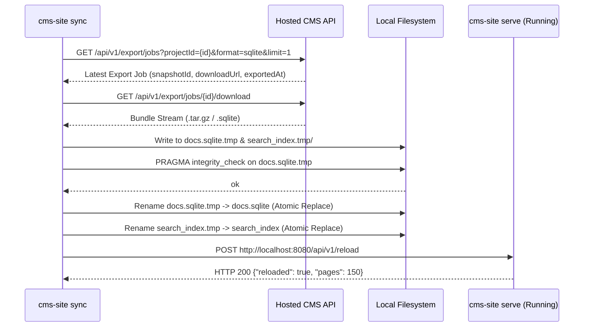

# Design Specification: CMS Runner Doctor, RMCP Version Selection, Auto-Sync & Crate Architecture

- **Date:** 2026-10-17
- **Status:** Approved
- **Target Branch:** `feat/runner-mcp-windows-custom-id`
- **Component:** `apps/runner` (`cms-runner`, binary `cms-site`), `crates/cms-sites`

---

## 1. Executive Summary & Goals

This specification details four key expert enhancements to the portable CMS documentation runner (`cms-site`):

1. **Crate Architecture & Modularization:**
   - Establish `[lib]` in `apps/runner/Cargo.toml` (`cms_runner`) alongside the existing `[[bin]]` (`cms-site`).
   - Cleanly delineate module boundaries (`windows`, `mcp`, `diagnostics`, `sync`, `router`, `state`) so runner components can be reused, unit tested, and integration tested cleanly.
   - Clarify architectural roles between `crates/cms-sites` (hosted SaaS backend site renderer) and `apps/runner` (portable offline documentation server & agent MCP provider).

2. **`cms-site doctor` Diagnostic & Health Suite:**
   - Implement an automated health check command inspecting the entire local operational environment:
     - Windows user PATH configuration (`HKCU\Environment`).
     - Custom URL protocol scheme registration (`HKCU\Software\Classes\cms-doc`) and target binary path consistency.
     - SQLite file presence, permission checks, `PRAGMA integrity_check`, and schema version validation.
     - Tantivy search index integrity (schema match, Japanese Sudachi tokenizer, doc count parity with SQLite).
     - Bind port collision detection (detects whether port is free, occupied by another `cms-site` responding to `/healthz`, or blocked by a foreign process).
   - Structured terminal report using standard status glyphs (`✓`, `!`, `✗`) with actionable remediation instructions.

3. **RMCP Version Discovery & Scoped Deep-Linking:**
   - New tool in embedded MCP server: `list_versions` to allow AI agents (Cursor, Claude, Antigravity) to inspect available releases and version metadata directly.
   - Extended `cms-site open <id>` CLI command with `--version <slug_or_id>` and `--lang <code>` flags.
   - Support for query-string-bearing deep links: `cms-doc://<id>?version=v2.0&lang=ja`.

4. **`cms-site sync` Auto-Update & In-Process Hot-Reload:**
   - `cms-site sync` command to pull the latest SQLite export and Tantivy bundle from the hosted CMS API server (`/api/v1/export/jobs/{id}/download`).
   - Configuration persistence via `.cms-site.json` or `%LOCALAPPDATA%\cms-site\config.toml`.
   - Atomic staging and verification (`.tmp` swap after `PRAGMA integrity_check`).
   - Zero-downtime hot reload: server state wrapped in atomic pointers (`ArcSwap` or `tokio::sync::RwLock`), notified via loopback `POST /api/v1/reload` or file watcher.

---

## 2. Crate Architecture & Library Modularization

### 2.1 Workspace Structure
```text
apps/runner/
├── Cargo.toml          # defines [lib] cms_runner AND [[bin]] cms-site
└── src/
    ├── lib.rs          # exports modules and core router/state interfaces
    ├── main.rs         # thin CLI entrypoint with clap dispatch
    ├── diagnostics.rs  # doctor check implementations
    ├── mcp.rs          # rmcp server tools & stdio/http transports
    ├── sync.rs         # remote export fetcher & atomic unpacking
    ├── windows.rs      # Windows registry & environment module
    └── search.rs       # Tantivy & FTS5 search engines
```

### 2.2 `apps/runner/Cargo.toml`
```toml
[package]
name = "cms-runner"
version = "0.1.0"
edition = "2021"

[lib]
name = "cms_runner"
path = "src/lib.rs"

[[bin]]
name = "cms-site"
path = "src/main.rs"
```

### 2.3 Distinction with `crates/cms-sites`
- `crates/cms-sites`: In-process rendering and routing for the multi-tenant hosted CMS web platform (`cms-server`). Operates on PostgreSQL and object storage.
- `apps/runner` (`cms_runner` / `cms-site`): Portable, standalone, zero-dependency offline documentation viewer, MCP server, and registry manager. Operates on local SQLite and Tantivy indexes.

---

## 3. `cms-site doctor` Diagnostic & Health Suite

### 3.1 CLI Invocation
```bash
cms-site doctor [--db <path>] [--dir <path>] [--port <port>]
```

### 3.2 Diagnostic Checklist & Logic

| Category | Diagnostic Check | Success Criteria | Remediation on Failure |
|---|---|---|---|
| **Windows PATH** | Check `HKCU\Environment\Path` | Current executable directory is present | `cms-site install` |
| **URL Protocol** | Check `HKCU\Software\Classes\cms-doc` | `cms-doc` scheme exists & points to `current_exe` | `cms-site install` |
| **Path Parity** | `shell\open\command` target matches `current_exe` | Exact executable path match (detects moved binary) | `cms-site install` |
| **SQLite Existence** | Check database file path | File exists and has read permissions | Provide valid `--db` or `--dir` |
| **SQLite Integrity** | `PRAGMA integrity_check` | Returns `ok` | Database corrupted; re-export snapshot |
| **Schema Version** | Query `export_meta.schema_version` | Value == 1 | Re-export from compatible CMS release |
| **Index Parity** | SQLite `pages` count vs Tantivy docs count | Page count == unique document count | Re-index with export pipeline |
| **Tantivy Tokenizer**| Initialize `lindera-sudachidict` | Tokenizer loads without error | Check system memory / dict files |
| **Port Collision** | TCP socket bind probe on target port | Port is available OR running `cms-site` (`/healthz`) | Another app occupies port; specify `--port` |

### 3.3 Output Formatting
```text
CMS Site Runner Diagnostic Suite
Target Database: D:\Workspace\Software\_working\cms-rs-3\target\demo-site\docs.sqlite
Binary: D:\Workspace\Software\_working\cms-rs-3\target\debug\cms-site.exe

[✓] Windows PATH: Binary directory is present in HKCU\Environment.
[✓] Protocol Handler: 'cms-doc://' registered to current executable path.
[✓] SQLite Database: Database file exists and passed PRAGMA integrity_check.
[✓] Schema Version: Version 1 (compatible).
[✓] Pages & Metadata: 4 pages, 2 languages ('en', 'ja'), 1 version ('v1.0').
[✓] Search Engine: SQLite FTS5 index verified (Tantivy index: not configured).
[✓] Network Port: Port 8080 is available for binding.

All 7 checks passed. Runner environment is healthy.
```

---

## 4. RMCP Version Selection & Extended Deep-Linking

### 4.1 RMCP Tool: `list_versions`
Added to `apps/runner/src/mcp.rs`:
```rust
#[derive(Debug, Clone, Serialize, Deserialize, JsonSchema, Default)]
pub struct ListVersionsParams {}

#[derive(Debug, Clone, Serialize, Deserialize)]
#[serde(rename_all = "camelCase")]
pub struct VersionSummary {
    pub id: String,
    pub slug: String,
    pub label: String,
    pub is_default: bool,
    pub sort_order: i64,
    pub page_count: i64,
}
```
Tool implementation queries `versions` and joins `pages` count:
```sql
SELECT v.id, v.slug, v.label, v.is_default, v.sort_order, COUNT(p.id) as page_count
FROM versions v
LEFT JOIN pages p ON p.version_id = v.id
GROUP BY v.id
ORDER BY v.sort_order ASC
```

### 4.2 Extended `cms-site open` Parameters
CLI arguments extended:
```rust
#[derive(Parser, Debug, Clone)]
pub struct OpenArgs {
    /// Document UUID, custom ID (e.g., 'auth-guide'), or 'cms-doc://<id>' URL
    pub id: String,

    /// Optional documentation version to target
    #[arg(short, long)]
    pub version: Option<String>,

    /// Optional documentation language to target (e.g., 'en', 'ja')
    #[arg(short, long)]
    pub lang: Option<String>,

    /// Port of the running documentation server (default: 8080)
    #[arg(short, long, default_value_t = 8080)]
    pub port: u16,

    /// Base URL of the running documentation server
    #[arg(long, default_value = "http://localhost:8080")]
    pub server_url: String,
}
```

### 4.3 URL Query Parameter Preservation in `open`
When `id` is a URI like `cms-doc://auth-guide?version=v2.0&lang=ja` or explicit CLI flags are provided:
- Flags take precedence over URI query params.
- Appends query parameters to redirect request: `http://localhost:8080/p/auth-guide?version=v2.0&lang=ja`.

---

## 5. `cms-site sync` Auto-Update & In-Process Hot-Reload

### 5.1 CLI Subcommand
```rust
#[derive(Parser, Debug, Clone)]
pub struct SyncArgs {
    /// Hosted CMS API server URL (e.g. "https://cms.internal.company.com")
    #[arg(long)]
    pub server: Option<String>,

    /// Project ID or slug to sync documentation for
    #[arg(long)]
    pub project: Option<String>,

    /// API authentication token (or reads CMS_API_KEY environment variable)
    #[arg(long, env = "CMS_API_KEY")]
    pub api_key: Option<String>,

    /// Output directory for downloaded documentation bundle
    #[arg(long, default_value = "docs")]
    pub out_dir: PathBuf,

    /// Watch mode interval in seconds (if specified, polls for updates continuously)
    #[arg(long)]
    pub watch: Option<u64>,

    /// Port of running cms-site server to notify for hot-reload
    #[arg(long, default_value_t = 8080)]
    pub notify_port: u16,
}
```

### 5.2 Atomic Swap Lifecycle


### 5.3 Hot-Reload in `cms-site serve`
- `AppState` wraps `db: ArcSwap<SqlitePool>` and `search: ArcSwap<Option<Arc<TantivySiteSearch>>>`.
- Exposes `POST /api/v1/reload`:
  - Loopback-only security guard: rejects requests from non-loopback addresses (`is_loopback_host`).
  - Re-opens SQLite read-only connection pool.
  - Re-opens Tantivy search index if present.
  - Atomically swaps internal references in `AppState`.
  - Zero dropped connections or socket resets.

---

## 6. Testing & Quality Gates

1. **`diagnostics` Unit & Integration Tests:**
   - Validates all check passes on mock healthy database.
   - Validates detection of broken/corrupted SQLite database.
   - Validates detection of stale registry executable path.
   - Validates port collision detector against active listener.
2. **`list_versions` MCP Tool Tests:**
   - Verifies JSON-RPC tool response with correct version schema and page count joins.
3. **`cms-site open` Parameter Tests:**
   - Tests flag serialization with `--version` and `--lang`.
   - Tests deep-link query parameter parsing (`cms-doc://id?lang=ja`).
4. **`sync` and Hot-Reload Tests:**
   - Tests atomic file replacement logic.
   - Tests `POST /api/v1/reload` on running Axum test router and verifies updated content is immediately queryable without restart.
