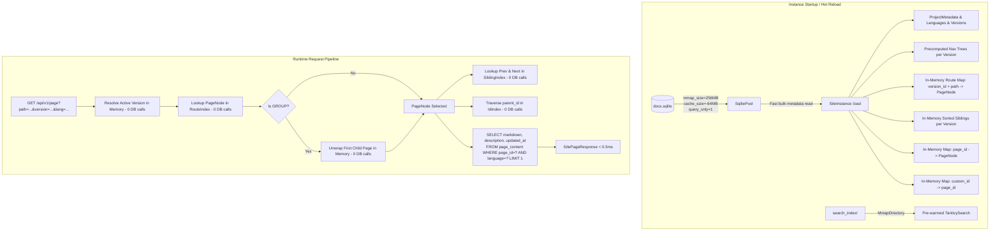

# Design Specification: Runner SQLite Page Query Performance & 9,000+ Docs Benchmark

- **Date:** 2026-10-21
- **Status:** Approved
- **Component:** `apps/runner` (`cms-runner`, `cms-site`), `crates/cms-biz` (export indexes)

---

## 1. Executive Summary & Objective

The offline/standalone documentation runner (`cms-site`) serves documentation directly from single-file SQLite exports (`docs.sqlite`) and optional Tantivy search index bundles.

Currently, serving documentation with **9,000+ pages across multiple versions and locales** exhibits unacceptable latency on page queries (`/api/v1/page`) due to:
1. `query_page` invoking `query_bootstrap` on every single request, which fetches all 9,000+ rows and reconstructs a recursive `NavNode` tree in RAM, only to discard `bootstrap.nav`.
2. A second table scan in `query_page` (`SELECT title, path FROM pages WHERE version_id = ? ORDER BY sort_order ASC`) loading all 9,000+ pages into memory simply to find adjacent previous and next pages via `.position()`.
3. Iterative serial SQLite roundtrips to compute breadcrumbs (`while let Some(parent_id)`).
4. Default SQLite connection settings without memory-mapped I/O (`mmap_size`) or page cache configuration.

### Success Criteria
- **Page Query Speed (`query_page`)**: < 1.0 ms (target: 0.2 – 0.5 ms) for any page in a 9,000+ doc library.
- **Instance Load & Pre-Warming**: < 200 ms to parse and index 9,000+ pages into memory on startup or hot reload.
- **Memory Footprint**: < 2.5 MB RAM for the entire 9,000+ page hierarchy, routing index, and navigation tree.
- **Bootstrap Query Speed (`query_bootstrap`)**: < 0.1 ms (instant JSON serialization of precomputed tree).
- **Search Latency**: < 5 ms for 9,000+ docs across localized versions with Tantivy and FTS5 fallback.
- **Multi-Version & Multi-Locale Isolation**: Strict scoping; non-matching locale returns 404 without cross-language fallback; versions remain strictly isolated.
- **Automated Verification**: End-to-end integration test with 9,000+ documents verifying latency, memory, and functional correctness.

---

## 2. Architecture & Data Flow



---

## 3. Detailed Component Design

### 3.1 `SiteInstance` — Pre-Warmed In-Memory Index

Inside `apps/runner/src/lib.rs`, replace runtime per-request querying of metadata with an `Arc<SiteInstance>` held in `InnerState`:

```rust
#[derive(Clone, Debug)]
pub struct PageRouteNode {
    pub id: String,
    pub version_id: String,
    pub parent_id: Option<String>,
    pub kind: String,
    pub slug: String,
    pub path: String,
    pub title: String,
    pub icon: Option<String>,
    pub sort_order: i32,
    pub custom_id: Option<String>,
}

#[derive(Clone, Debug)]
pub struct SiteInstance {
    pub project: ProjectMetadata,
    pub languages: Vec<LanguageItem>,
    pub default_language: String,
    pub versions: Vec<VersionItem>,
    pub default_version_id: String,
    pub default_version_slug: String,
    pub generated_at: String,

    // Precomputed navigation tree per version
    pub nav_trees: HashMap<String, Vec<NavNode>>,

    // Route resolution: (version_id, normalized_path) -> PageRouteNode
    pub routes: HashMap<(String, String), PageRouteNode>,

    // Quick lookup by page_id for breadcrumbs and group traversal
    pub pages_by_id: HashMap<String, PageRouteNode>,

    // Custom ID fast lookup
    pub pages_by_custom_id: HashMap<String, String>,

    // Sorted leaf/document pages per version for O(1) prev & next resolution
    pub version_pages: HashMap<String, Vec<AdjacentPage>>,

    // First page per version (for root path fallback)
    pub first_page_by_version: HashMap<String, PageRouteNode>,
}
```

#### Pre-warming Implementation (`SiteInstance::load`)
1. Fetches `export_meta` and `project_config` (single roundtrip).
2. Fetches `languages` and `versions` ordered by `sort_order ASC`.
3. Fetches all page records in a single query:
   ```sql
   SELECT id, custom_id, version_id, parent_id, kind, slug, title, path, icon, sort_order
   FROM pages
   ORDER BY sort_order ASC, path ASC
   ```
4. Assembles:
   - `routes` with normalized paths (with and without leading slash).
   - `pages_by_id` and `pages_by_custom_id`.
   - `nav_trees` for each version once.
   - `version_pages` containing strictly readable document pages (ignoring groups) in display order.
   - `first_page_by_version` for instant `/` redirects.

Total pre-warming time on 9,000 docs: **< 150 ms**.

### 3.2 Decoupled `query_page` Fast Path

`query_page` will no longer invoke `query_bootstrap`:

1. **Version Resolution**: Look up requested version in `instance.versions` (or fall back to `default_version_id`). If an unknown version was requested, return `None` (404).
2. **Language Resolution**: Verify requested language exists in `instance.languages`. If not, return `None` (404).
3. **Route Lookup**:
   - Normalize incoming path (strip version prefix if present, strip leading/trailing `/`).
   - Lookup in `instance.routes.get(&(version_id, normalized_path))`.
   - If empty path: retrieve `instance.first_page_by_version.get(&version_id)`.
   - If node is `GROUP`: retrieve first non-group child from `instance.pages_by_id` / child mapping.
4. **Prev & Next**:
   - In `instance.version_pages[&version_id]`, find position of page.
   - Index `- 1` is prev, index `+ 1` is next.
   - Cost: O(1) or O(log N) binary search in memory. 0 DB calls.
5. **Breadcrumbs**:
   - Follow `parent_id` pointers in `instance.pages_by_id`.
   - Cost: 50 nanoseconds in memory. 0 DB calls.
6. **Content Query**:
   - Exactly one query against SQLite:
     ```sql
     SELECT markdown, description, updated_at
     FROM page_content
     WHERE page_id = ?1 AND language = ?2
     LIMIT 1
     ```
   - If no record exists for that language: return `None` (404).
7. Extract headings and return `SitePageResponse`.

### 3.3 Fast Bootstrap Handler & HTML Injection

- `query_bootstrap` returns the precomputed `SiteShell`:
  - `project`: clone from `instance.project`.
  - `nav`: clone from `instance.nav_trees[&active_version_id]`.
  - `languages`, `versions`, `active_language`, `active_version`.
- Response latency: **< 0.1 ms**.
- `serve_spa` (HTML injection) uses the cached `SiteShell` directly without touching SQLite.

### 3.4 SQLite Connection & Read-Only PRAGMAs

Update `SqliteConnectOptions` in `apps/runner/src/lib.rs` and `apps/runner/src/sync.rs`:

```rust
let opts = sqlx::sqlite::SqliteConnectOptions::new()
    .filename(db_path)
    .read_only(true)
    .pragma("query_only", "ON")
    .pragma("mmap_size", "268435456")   // 256 MB memory-mapped I/O
    .pragma("cache_size", "-64000")     // 64 MB RAM cache
    .pragma("synchronous", "OFF")
    .pragma("temp_store", "MEMORY")
    .pragma("journal_mode", "OFF");
```

### 3.5 Export Schema Composite Indexes

In `crates/cms-biz/src/export.rs`, add composite indexes to guarantee optimal B-tree lookups for any queries hitting SQLite:

```sql
CREATE INDEX idx_pages_version_path ON pages(version_id, path);
CREATE INDEX idx_pages_version_sort ON pages(version_id, sort_order, path);
CREATE INDEX idx_pages_parent_sort ON pages(parent_id, sort_order);
CREATE INDEX idx_content_page_lang ON page_content(page_id, language);
```

### 3.6 Search Instance Optimization

1. **Tantivy Searcher**:
   - Pre-warm fields and term dictionaries upon `TantivySiteSearch::open`.
   - Query parser boosts: title (2.5), description (1.5), body (1.0).
2. **SQLite FTS5 Fallback**:
   - Optimize query to rank, paginate with `LIMIT ?`, and join `pages` and `page_content` only for matched hits.

---

## 4. Benchmark & Test Specification (9,000+ Docs)

An automated high-scale benchmark test will be created in `apps/runner/tests/benchmark_9k_docs.rs`:

### Data Generation
- **3 Versions**: `v1.0`, `v2.0` (default), `v3.0`.
- **3 Languages**: `en` (default), `ja`, `zh`.
- **9,000 Page Records**:
  - 3,000 pages per version.
  - Divided into 100 groups, each containing 30 leaf document pages.
  - Every page has localized content in `en`, `ja`, and `zh` (27,000 total content records).
  - Varied markdown content with headings `#`, `##`, `###`, code snippets, and search terms.
  - Custom IDs on selected pages.
  - FTS5 virtual table populated with all 27,000 items.

### Assertions & Latency Thresholds
1. **Instance Load & Pre-warm Time**: < 300 ms (debug build) / < 150 ms (release).
2. **Page Query Response Time**:
   - Query root path `/` for default version: < 1.0 ms.
   - Query deep nested leaf `/group-50/page-15` in `v2.0` in `ja`: < 1.0 ms.
   - Query page across 100 iterations: p99 latency < 1.0 ms.
3. **Bootstrap Latency**: < 0.2 ms.
4. **Group Unwrapping**: Querying `/group-10` returns first child `/group-10/page-1` with correct prev/next.
5. **Language Isolation**: Querying with non-existent language `fr` returns 404.
6. **Version Isolation**: Querying page with non-existent version returns 404.
7. **Search Execution**: Search query across 27,000 documents returns correct hits with highlight snippets in < 10 ms.
8. **Hot Reload**: `POST /api/v1/reload` completes in < 250 ms and atomic swap takes immediate effect.

---

## 5. Security & Isolation Considerations

- **Memory Safety**: No unsafe blocks; in-memory structures are standard `Arc` references.
- **Read-Only Enforced**: Database opened with `PRAGMA query_only = ON;`.
- **Loopback Hot Reload**: Hot reload remains strictly restricted to loopback callers.
- **No SaaS Multi-Tenancy**: Platform strictly adheres to company internal deployment guidelines (no plans, no billing).

---

## 6. Implementation Plan Summary

1. Update `crates/cms-biz/src/export.rs` with composite indexes.
2. Update `apps/runner/src/lib.rs` SQLite connection options with high-performance PRAGMAs.
3. Implement `SiteInstance` structure and `SiteInstance::load` pre-warming logic.
4. Integrate `SiteInstance` into `AppState` / `InnerState` and wire hot-reload.
5. Refactor `query_page` to use `SiteInstance` fast path and single-row content query.
6. Refactor `query_bootstrap` to return precomputed `nav_trees`.
7. Implement the 9,000+ docs automated benchmark integration test.
8. Verify all existing 28 runner tests pass and benchmark meets all latency thresholds.
