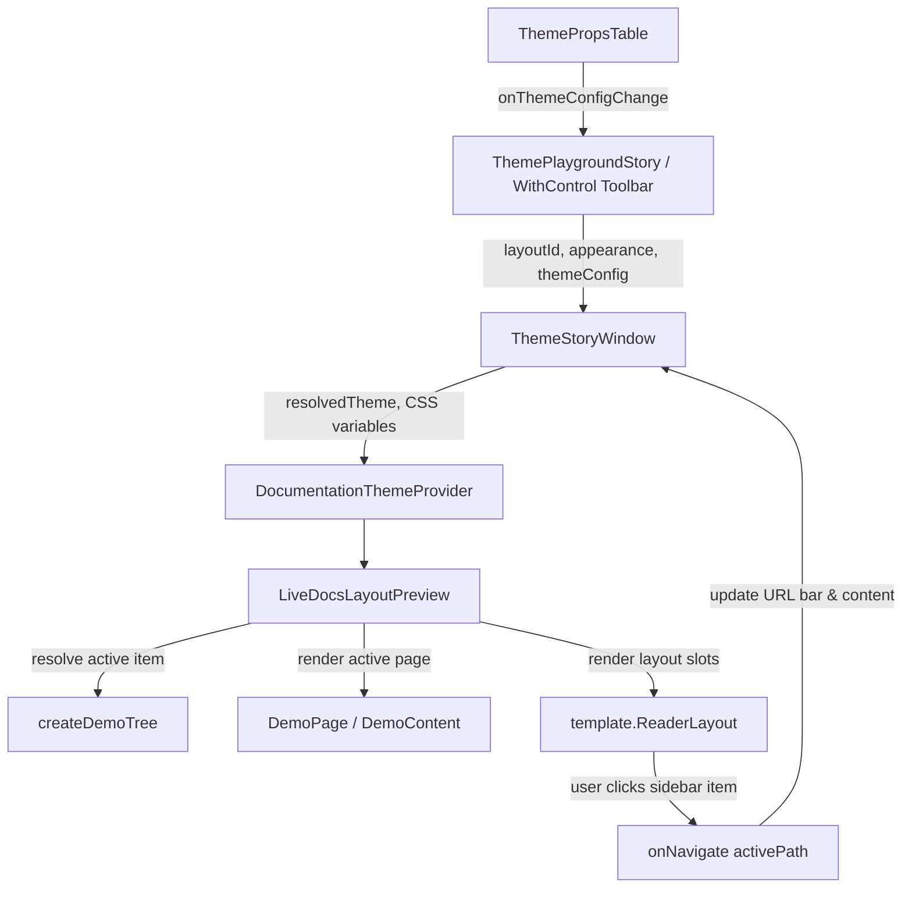

# Fumadocs Live Layout Preview (`WithControl`) Design Specification

- **Date:** 2026-10-23
- **Topic:** Rewrite live WithControl preview playground with authentic Fumadocs real layout engine
- **Scope:** `packages/site/src/preview/`, `apps/studio/src/features/project-settings/components/theme/`

---

## 1. Problem Statement & Motivation

In the Theme Playground (`ThemePlaygroundStory`), users test layout options (`docs`, `notebook`, `spacious`, `flux`, `glass`) within a macOS window chrome (`ThemeStoryWindow`).

The previous implementation suffered from critical issues:
1. **1,462 lines of brittle static mock JSX**: Rather than executing the actual layout components, `theme-story-window.tsx` manually mocked every element with hardcoded dummy structures.
2. **Broken dummy grids (`StudioPreviewLayout`)**: Layouts like `notebook` were forced into a miniature `grid-cols-[7rem_1fr]` frame that collapsed when clicking items such as "Tabs" or "Cards", rendering a blank white screen.
3. **Divergence from Fumadocs upstream**: Upstream Fumadocs (`c:/Users/Admin/Downloads/fumadocs/apps/docs/components/layout-preview/*`) renders the **real `DocsLayout`** (`ReaderLayout`) with an authentic page tree (`createTree`) and dynamic `<DemoPage>` containing interactive `<Tabs>`, `<Cards>`, `<Callout>`, and code blocks.

---

## 2. Architecture & Design

### 2.1 Component Architecture in `@cms/site`

We introduce a dedicated, reusable preview subsystem in `packages/site/src/preview/`:

```
packages/site/src/preview/
├── demo-tree.ts            # Authentic Fumadocs page tree data model
├── demo-content.tsx        # Authentic Fumadocs interactive demo components
├── live-layout-preview.tsx # Mounts real template.ReaderLayout with authentic slots
└── index.ts                # Package exports
```

#### A. `demo-tree.ts`
Builds the Fumadocs standard page hierarchy:
- **Framework Root**:
  - Introduction: `Overview` (`""`), `Quick Start` (`quick-start`), `Themes` (`themes`)
  - Writing: `Markdown` (`markdown`), `Search` (`search`)
  - Components Folder: `Callout` (`components/callout`), `Cards` (`components/cards`), `Tabs` (`components/tabs`)
  - Deployment Folder: `Static Export` (`deployment/static`), `Docker` (`deployment/docker`)
- **API Reference Root**:
  - `Introduction` (`api`), `Authentication` (`api/authentication`)
  - Pages Folder: `List Pages` (`api/pages`), `Get Page` (`api/pages/get`), `Delete Page` (`api/pages/delete`)

#### B. `demo-content.tsx`
Provides the interactive page body based on the active path:
- **Default/Overview**:
  - Heading 2: "Introduction"
  - Interactive `<Cards>`: Quick Start & Themes with click callbacks
  - Heading 2: "Installation" with interactive `<Tabs>` (`npm`, `pnpm`, `yarn`) and syntax code snippet
  - Heading 2: "Usage" with code block
  - Heading 3: "Configuration"
  - `<Callout title="Good to know">`
  - Heading 2: "Deployment"
- **Specialized Pages**:
  - `components/tabs`: Focused tabs showcase (Underline, Pills, Boxed variations)
  - `components/cards`: Focused cards showcase (Bordered, Lifted, Flat variations)
  - `components/callout`: Focused callouts showcase (Note, Tip, Warning, Info)
  - `themes`: Themes and Color Tokens showcase

#### C. `live-layout-preview.tsx`
Executes `template.ReaderLayout`:
- Receives:
  - `layoutId: DocsLayoutId` (`notebook`, `glass`, `flux`, `spacious`, `docs`)
  - `activePath: string`
  - `onNavigate: (path: string) => void`
  - `theme: ResolvedTheme`
  - `layoutOptions: Partial<ThemeLayout>`
- Feeds authentic granular slots:
  - `brand`: Dynamic project/brand title with theme radius
  - `searchFull` & `searchButton`: Authentic search triggers
  - `tools`: Theme switcher (light/dark) + GitHub icon link
  - `navLinks`: "Guide", "Components", "API Reference"
  - `navTabs`: Tabs corresponding to the active root folder
  - `sidebarTree`: Interactive tree nodes with folder expand/collapse and active page highlighting
  - `content`: `template.PageLayout` containing breadcrumbs, `<DemoPage>`, and real `<TableOfContents>`

---

### 2.2 Refactoring `ThemeStoryWindow`

`apps/studio/src/features/project-settings/components/theme/theme-story-window.tsx` is reduced from 1,462 lines to ~150 lines:
1. **Window Frame**:
   - macOS header with red/yellow/green buttons.
   - Maximize/Restore button hooked to `onToggleFullscreen`.
   - Real-time address bar: `https://docs.local/preview/{layoutId}{activePath ? `/${activePath}` : ''}`.
2. **ThemeProvider Wrapper**:
   - `DocumentationThemeProvider` supplying live CSS variables (`--primary`, `--radius`, `--theme-header`, etc.) from `ThemePropsTable`.
3. **Mounting**:
   - Renders `<LiveDocsLayoutPreview />` passing the current `layoutId` and handling navigation state updates.
   - Height adapts: `max-h-[460px]` with inner scrolling in standard mode; full viewport `100vh` in fullscreen mode.

---

## 3. Data Flow



---

## 4. Testing & Verification

1. **Unit Tests**:
   - `packages/site/src/preview/demo-tree.test.ts`: Verify node structure, paths, and icons.
   - `packages/site/src/preview/live-layout-preview.test.tsx`: Render all 5 layouts (`docs`, `notebook`, `spacious`, `glass`, `flux`) and test navigation to `components/tabs`.
   - `apps/studio/src/features/project-settings/components/theme/theme-story-window.test.tsx`: Verify address bar updates and fullscreen handling.
2. **Typecheck**:
   - `bun run typecheck` across `apps/studio` and `packages/site`.
3. **Browser Verification**:
   - Verify `http://localhost:4310/app/projects/:id/settings?section=branding`.
   - Inspect `notebook` layout: click "Tabs" and ensure no blank white box occurs.
   - Switch through all 5 layouts and check that each renders properly.
